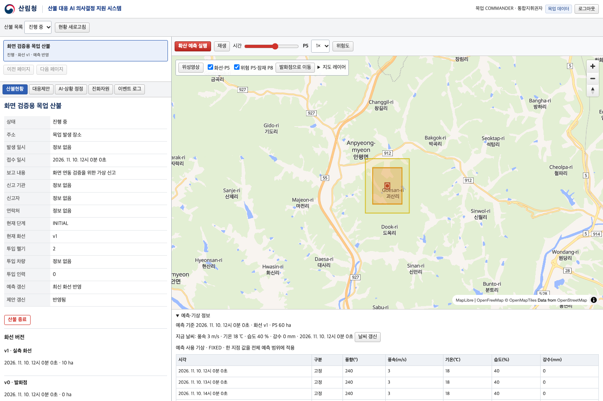
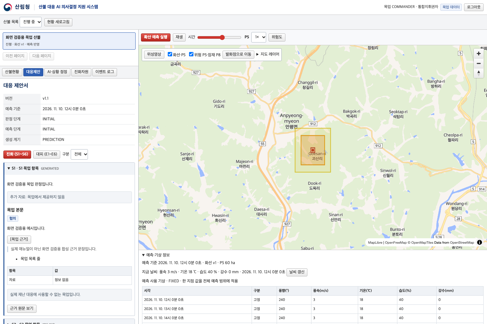

# API 화면 연결·동작 점검

점검일: 2026-11-10(KST). 기준 명세·확정 API 목록은 [연동 가이드](API-INTEGRATION.md)에 있습니다.

## 결과

| 확인 항목                                             | 결과                                           |
| ----------------------------------------------------- | ---------------------------------------------- |
| 전체 프로젝트 및 API·연결 화면 strict TypeScript 검사 | 통과                                           |
| API 단위/흐름·입력 검증·기존 모델 회귀 테스트         | 74개 통과                                      |
| Chromium 화면 시나리오                                | 9개 통과                                       |
| 브라우저 화면 조작에서 호출된 계약 API                | 34/34개                                        |
| 프로덕션 빌드                                         | 통과. MapLibre 포함 번들 크기 경고는 남음      |
| 실제 일반지도와 API 도형 표시                         | OpenFreeMap 배경·화선·P5/P8 표시 확인          |
| 실제 백엔드·EC2·DB·GPU·LLM 통합                       | 미점검. 접속 정보와 실제 API 준비 후 별도 확인 |

브라우저 자동 테스트는 **http 모드**에서 요청을 가로채 `createMockFetch`의 합성 응답으로 처리합니다. 실제 서버에 요청하거나 DB를 변경하지 않습니다. 외부 바탕지도는 테스트용 배경으로 대체하여 테스트가 인터넷 상태에 좌우되지 않게 했습니다. 별도로 기본 mock 모드에서 실제 일반지도를 띄워 배치·도형 표시를 확인했습니다.

## 연결한 화면과 API

| 화면           | 연결한 API                   | 점검 내용                                                                               |
| -------------- | ---------------------------- | --------------------------------------------------------------------------------------- |
| 로그인         | AUTH-01·02·03                | 4개 역할 로그인, 내 정보 확인, 로그아웃, 토큰 만료 시 재로그인                          |
| 산불 목록·현황 | INC-01·02·03·04              | 진행/종료 조회, 선택·상세, 발화점 보고, 종료 전 확인·종료 후 예측 제한                  |
| 현장 보고      | PER-01·02·03                 | v0 발화점·v1 실측·v2 정정 구분, 버전 목록, 보고·정정 저장                               |
| 지도           | MAP-01·02                    | 레이어 목록, bbox·커서 조회, 지도 이동/레이어 전환 시 이전 요청 취소, 도형 표시         |
| 예측 실행·결과 | PRED-01~05, WTH-01           | 연속 클릭 방지, 202 작업 조회, 대기 중지·동일 작업 재조회, P1~P8 재생, 시간별/현재 기상 |
| 위험도         | RISK-01                      | 23변수·소수 등급 보존, 미제공 자료의 정보 없음 표시                                     |
| 대응 제안서    | PROP-01~04                   | 최신·과거 버전, 진화 6칸/대피 6칸, 블록 본문, 근거 원문, 직전 버전 비교                 |
| AI·상황 정정   | AI-01·02, COR-01·02, PROP-05 | 질의응답, 미저장 확인안, 취소, 확인 후 저장, 이력, 제안 실패 후 제안만 재생성           |
| 진화자원       | RES-01·02, BASE-01           | 종류/상태 필터, 자원 목록·집계·기지, 빈 목록·nullable 거리                              |
| 관리자         | USR-01·02                    | 계정 목록·필터, 계정 발급, 임시 비밀번호 표시·닫기                                      |
| 이벤트 로그    | LOG-01                       | 산불/관리자 문맥 조회, 이벤트 코드 검색, 빈 결과                                        |

미확정 API 12개는 실행 가능한 버튼으로 가장하지 않습니다. 자원·기지 수정/삭제와 계정 수정/회수 등은 미연결 안내만 표시합니다. 계약에 없는 산불명·기관별 접수 기록·산불 병합 필드를 서버에 전송하지 않습니다.

## 브라우저 시나리오

1. 지휘권자 로그인 → 목록·상세 → 지도·위험도 → 제안·근거·비교 → 자원·로그 → 예측 → 산불 종료 → 로그아웃
2. 보고자 새 산불(v0) 등록 → GeoJSON 화선 보고(v1) → 현재 화선 정정(v2), 지휘권자 제어가 표시되지 않음
3. 관리자 계정 조회·발급 → 임시 비밀번호 닫기 → 자원·기지·로그 조회
4. 정정 확인안 취소(저장 요청 없음) → 저장 → 제안 생성 실패 → 제안만 재시도(정정 중복 저장 없음)
5. 최신 제안·위험도 null, 풍속 0·습도 null 구분, 503 오류 재시도, 401 로그인 만료
6. 빈 산불 목록과 390px 모바일 화면에서 조회·로그아웃
7. 경도만 입력했을 때 위도가 임의로 채워지지 않음, 지도 발화점 지정·화선 그리기, 잘못된 GeoJSON 차단
8. 예측 충돌(409) → 재요청 → 프론트 대기 중지 → 같은 작업 재조회(새 작업 중복 요청 없음)
9. 느린 응답 중 로그아웃 후 이전 화면이 복구되지 않음, 데이터가 있는 모바일 화면의 가로 넘침 없음

단위 테스트에서는 HTTP 상태·헤더·쿼리·본문 직렬화, 204, 401/403/404/409/422/500/503, 네트워크 실패·타임아웃·요청 취소, 문자열 BIGINT ID, 멱등키 재사용 충돌, 작업 실패 시 이전 결과 유지, stale 정정 거절도 확인합니다.

## 점검 중 수정한 문제

- MapLibre 기본 CSS와 겹쳐 지도 컨테이너 높이가 0이 된 문제: 앱 범위를 포함한 선택자로 지도 위치·너비·높이를 고정하고, 클릭·그리기 및 지도 높이를 테스트합니다.
- 기존 일반지도 대체 타일에서 API 키 안내 이미지가 나온 문제: 원본에서 사용하던 [OpenFreeMap 공식 스타일](https://openfreemap.org/quick_start/)을 적용했습니다. 외부 스타일 로딩 실패 시에도 로컬 배경 위 API 도형을 유지하고 안내합니다.
- 조회 갱신이 하위 화면을 지워 진행 중인 정정/작업 조회를 취소할 수 있는 문제: 같은 문맥의 재조회에서는 이전 데이터를 유지하고 갱신 상태를 표시합니다. 산불·필터 등 문맥이 바뀌면 이전 데이터를 숨기고 이전 요청을 취소합니다.
- 한 좌표를 입력했을 때 다른 좌표를 임의의 기본값으로 채울 수 있는 문제: 두 좌표가 모두 유효할 때만 지도와 제출 데이터에 반영합니다.

## 화면 예시

모두 합성 목업 데이터입니다. 일반지도는 외부 제공자의 지도입니다.





## 재현 방법

```bash
npm ci
npx playwright install chromium
npm run typecheck
npm test
npm run test:e2e
npm run build
```

Playwright가 5187번 포트에서 전용 개발 서버를 시작·종료합니다. 개발자가 켜둔 서버를 재사용하지 않습니다. 결과·실패 스크린샷·트레이스와 `api-browser-coverage.json`은 `test-results/`에 생성되고 Git에서는 제외합니다. 테스트가 중간 실패해 작업자가 재시작한 경우 마지막 작업자의 호출 목록만 남을 수 있으므로, 전체 통과 실행의 결과를 기준으로 보세요.

## 실제 연동 때 남은 확인

- 브라우저용 API 주소, SSH 터널/프록시·CORS, 테스트 계정·역할·관할
- 실제 응답 필드와 null/선택 필드, 권한·관할, 실측 화선 시각·기하 검증
- 실제 기상·위험도·ELMFIRE·LLM·근거 데이터의 제공 범위와 지연/실패 응답
- 서버 재시작 시 작업 조회, 동시 정정/종료·화선 변경 충돌, 재시도·멱등성
- 실제 데이터 규모에서 지도 페이지 조회·성능과 운영 배포 프록시

이 점검에서 프론트의 목업 연결과 화면 동작을 확인했습니다. 실제 서버 통합 완료를 뜻하지 않습니다.
