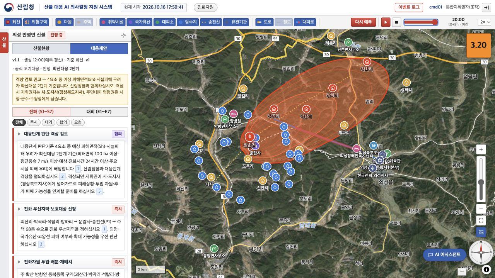

# 전환 검증 기록

검증일: 2026-10-16 (한국표준시)

## 실행 환경

- Node.js 24.19.0
- React / React DOM 19.3.1
- TypeScript 5.9.3
- Vite 8.3.4
- MapLibre GL JS 6.14.0
- 실제 브라우저의 로컬 개발 서버 및 별도 프로덕션 미리보기 서버

## 자동 검증

| 항목 | 결과 |
| --- | --- |
| 전체 TypeScript 타입 검사 | 통과 (`strict: false`, 점진적 타입 적용) |
| 프로덕션 빌드·워커 파일 생성 | 통과 |
| 일반 위험도 2회와 원본 계산 비교 | 통과 |
| 병합 산불 위험도와 원본 계산 비교 | 통과 |
| P1~P8 면적·첫 꼭짓점·닫힌 화선과 원본 비교 | 통과 |
| 누락 변수 제외 및 가중 평균 재계산 | 통과 |
| 마운트별 시나리오 데이터 독립성 | 통과 |
| 초기 권한 4종·접수 상태 보존 | 통과 |
| 원본 HTML의 고정 DOM ID 128개 보존 | 누락 없음 |
| 전체 초기 시나리오 데이터 | 원본 v4와 동일 |
| 로고 파일 | 원본과 SHA-256 일치 |
| npm 의존성 검사 | 알려진 취약점 0건 (검사 시점 기준) |

자동 테스트는 `npm test`의 테스트 6개이며, 원본 비교값은 `tests/fixtures/original-v4.json`에 있습니다. 빌드 시 MapLibre를 포함한 청크가 500 kB를 넘는 안내는 표시되지만 빌드는 성공합니다.

## 프로덕션 빌드에서 직접 조작한 흐름

| 흐름 | 관찰한 결과 |
| --- | --- |
| 통합지휘권자 로그인 → 예측 실행 | 제안 v1.1 생성, 5h 1,593 ha / 8h 4,077 ha |
| 위험도 팝업 | 3.20, 기상·지형·연료·인프라 점수 및 가중치 표시 |
| 대응제안 탭 | 진화 7항목·근거 번호·이력 표시 |
| 시간 슬라이더 → 8h → 처음으로 | 20:00 / t0+8h, 다시 12:00 / t0+0h로 이동 |
| AI 어시스턴트에 현재 위험도 질의 | 동일한 위험도·요소 점수·계산 시각 답변 |
| 열람자 로그인 | 대응제안·예측 실행 숨김, 상황도와 재생 제공 |
| 상황 보고자 → 신규 산불 저장 | 접수 상태로 생성 |
| GeoJSON 화선 적용 → 저장 | 화선 v2 / 약 4.4 ha 저장, 진행 중으로 전환 |
| 관리자 로그인 | 계정·권한 및 자원 관리 화면 표시 |
| 인력 자원 5명 등록 | 인력 보유 110 → 115명, 대기 50 → 55명 |
| 유일한 통합지휘권자 계정 회수 시도 | 원본 보호 규칙대로 처리 차단 및 사유 표시 |
| 제안 실패 시연 → 재시도 | 실패 안내 후 두 번째 시도에 v1.1 생성 |
| 진화자원 실패 시연 | 자원 창과 알림에 실패 사유 표시 |
| AI 답변 실패 시연 | 채팅에 답변 조회 실패 표시 |
| 병합 시연 | 두 산불 정보와 병합 범위, 위험도 3.17 표시 |

위 프로덕션 조작 중 브라우저 콘솔의 실행 오류는 관찰되지 않았습니다. 모든 유스케이스의 모든 조합을 완전 탐색한 것은 아닙니다. 실제 외부 예측·AI·인증 서비스와의 연동 및 운영 환경 검증은 포함하지 않습니다.

## 화면

